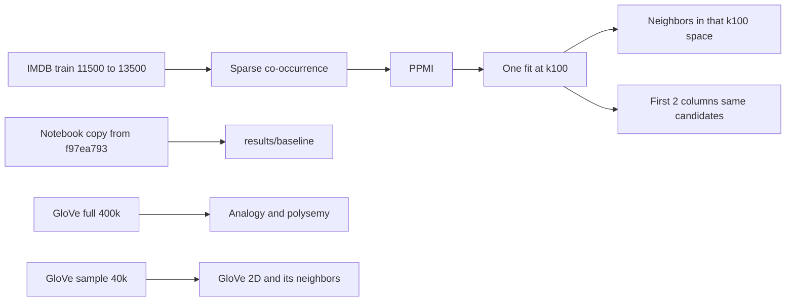

# A1 Embedding Study：第一阶段

分支 `a1-embedding-study` 已从 `f97ea793` 建好，计划提交是 `506c596`。不改 [assignments/a1/student/exploring_word_vectors.ipynb](assignments/a1/student/exploring_word_vectors.ipynb) 里的作业实现和已写答案。研究代码放在 `assignments/a1/research/`。

语料：研究实验用 HuggingFace `stanfordnlp/imdb` 的 **train[11500:13500]**（1000 条负评 + 1000 条正评）。作业 baseline 仍按现有 `train[:150]` 原样重跑。全部计算在本机 **M1 Pro（10 核，32 GB）** 上完成，使用 `cs224n` 环境。

## 已确认的语料与算力

HuggingFace 这份 IMDB 的 train 按标签排好序：`[0, 12500)` 全是负评，`[12500, 25000)` 全是正评。因此 `train[:150]` 和 `train[0:2000]` 都是纯负评。研究子集改成跨过分界的 `train[11500:13500]`，正负各 1000，索引范围固定，写入 `config.py`。

已在本机缓存上按作业同一套预处理量过这段（小写、`re.sub(r'[^\w]', '', ...)`、`<START>` / `<END>`）：

- 2000 篇，原文 **2.52 MiB**，**470,407** token，平均 235 token / 篇
- 词表 **29,052**；count ≥ 10 的词 **3,937**（evaluation vocabulary）
- 窗口 4 的共现矩阵：**1,429,134** 个非零项，密度 0.17%，CSR float64 约 **16.5 MiB**
- 若建成稠密 float64 矩阵则约 **6.3 GiB**。实现保持 `scipy.sparse`，不物化这张稠密矩阵

第一阶段是稀疏共现、PPMI 和 `sklearn.TruncatedSVD`，再加上本地已有的 GloVe 查询。这些库走 CPU。按上面的规模，SVD 扫描加几个 seed 预计是几分钟到十几分钟。后续同语料的 CBOW / SGNS 用 gensim，同样是 CPU，47 万 token 的一次训练一般是几分钟。这一阶段不使用 Hugging Face GPU。

## 现有作业里要对齐的不一致

这些写进 baseline 记录，扩展代码按记录的规模执行，不回头改作业 notebook。

- 正文写 25,000 train + 25,000 test。代码是 `NUM_SAMPLES = 150`，只取 `imdb_dataset["train"]["text"][:150]`。已保存输出里共现 SVD 的词表是 **5,880**。
- `print("corpus size:", len(imdb_corpus[0]))` 打的是第一篇的 token 数（输出 290），不是文档数。
- 正文写抽取 **40,000** 个 GloVe vectors。`get_matrix_of_vectors()` 遍历 `wv_from_bin.index_to_key` 全部词。已保存输出是 **400,000**。
- 文首 `np.random.seed(0)` / `random.seed(0)` 与 `get_matrix_of_vectors` 内部的 `random.seed(225)` 各自都是确定的。未写 `random_state` 的 `TruncatedSVD` 仍会跟着全局 NumPy 随机状态走。不稳定来自对全局状态和 cell 执行顺序的依赖，而不是这两次 `seed(...)` 本身不固定。
- 共现矩阵是 `np.zeros` 稠密矩阵。150 条、5,880 词大约可接受；词表再大就会撑爆内存。预处理还会把标点清成空字符串 token。

扩展版的明确选择：

- IMDB 研究语料：`train[11500:13500]`，预处理与作业相同（小写、`re.sub(r'[^\w]', '', ...)`、`<START>`/`<END>`）。空字符串 token 保留，并参与共现计数，以保持作业口径。标签分布是 1000 负 + 1000 正。
- 邻居候选和 PIP 子集排除 `""`、`<START>`、`<END>`。查询词本身不进入自己的邻居列表。某一行的 L2 范数为 0 时，该词不参与 cosine 检索，也不进入 PIP 子集，并记录剔除数量。query 不在语料中，或 count < 10 时，这条 query 记为不可评价，不为其降低阈值。
- 2D GloVe 可视化：固定抽取 **40,000** 个向量（seed 固定），并强制加入 query words。和这张 2D 图比较的邻居检索，两边都只用这同一批候选。完整 `glove-wiki-gigaword-200`（400,000 × 200）只用于不和该 2D 抽样比较的评价（多义词邻居、analogy）。不把 2D 投影当成这些评价本身。
- 共现与 PPMI 用 `scipy.sparse`，不对全词表做 pairwise 矩阵。

## 目录与可复现配置

```
assignments/a1/research/
  README.md
  config.py                 # 唯一配置入口
  src/                      # corpus, sparse counts, ppmi, svd, neighbors, analogy
  notebooks/phase1.ipynb    # 第一阶段可读笔记
  papers/                   # 八篇短笔记
  results/baseline/         # 从 f97ea793 导出的 notebook 副本及其输出
  results/phase1/<run_id>/  # 每次运行独立目录：config、seed、hash、指标
```

[config.py](assignments/a1/research/config.py) 是参数入口。每次运行写入自己的 `results/phase1/<run_id>/`，`run_id` 含模块名和 UTC 时间。该目录保存 `config.json`、seed、指标和下面的数据身份。后一次运行不覆盖前一次的 `config.json`。

数据身份：

- 数据集：`stanfordnlp/imdb`，配置 `plain_text`，split `train`，index `[11500, 13500)`。记录 `datasets` 缓存 revision，并断言等于已核对的 `e6281661ce1c48d982bc483cf8a173c1bbeb5d31`
- 断言标签数：负评 1000、正评 1000。断言预处理后 token 数：470,407（含空 token、`<START>`、`<END>`）
- 记录原始 2000 篇文本的 sha256，以及预处理后 token 流的 sha256。第一次归档写下这两个 hash，之后每次运行断言与归档一致
- 同时记录 `numpy` / `scipy` / `sklearn` / `gensim` / `datasets` 版本和 Python 版本

其他固定项：

- preprocessing、window=4、词表排序规则（与作业 `distinct_words` 一样按字符串排序）、`word2ind` 写成 json
- `SEED = 0`。凡是调用 `TruncatedSVD`，都显式传入 `random_state` 和 `n_iter=10`，不依赖全局 NumPy 状态或 cell 顺序
- 同一组 query words：作业里的 `movie, book, mysterious, story, fascinating, good, interesting, large, massive, huge`
- evaluation vocabulary：count ≥ 10，且不是 `""`、`<START>`、`<END>`。上面量到的 3,937 是排除这三项之前的计数；每次运行记录排除之后的候选数。neighbor 只在这个集合里检索

GloVe 仍用作业环境里的 `gensim.downloader` `glove-wiki-gigaword-200`。训练语料是 Wikipedia 2014 + Gigaword 5，约 60 亿 token，与 IMDB 子集不是同一分布。这个差别写进配置和 GloVe 小节，避免把差距全部算到算法上。




## 第一阶段要做完的实验

### Baseline

当前工作区里的作业 notebook 有未提交改动，但只涉及输出和执行计数，源码与答案没有变化。Baseline 不执行这份工作区文件。从 `f97ea793` 导出副本：

`git show f97ea793:assignments/a1/student/exploring_word_vectors.ipynb`

把副本放到 `results/baseline/`，用 `cs224n` 环境执行该副本，并保存 stdout、图和上面列出的不一致点。不改作业 cell。

### 模块 A：Raw counts 到 PPMI

对应作业 1.2–1.3。阅读笔记：[Levy & Goldberg 2015](https://aclanthology.org/Q15-1016/)，用 Arora et al. 2016 的短段说明 PMI 与 inner product 的近似关系，不复现证明。

- 手算小语料：打印 raw counts、word/context marginals、PMI、PPMI，并与手算结果逐项对照。语料里同时放一个高频功能词对和一个只共现一次的词对。
- 同一 IMDB 子集上三条线：Raw counts + SVD、PPMI + SVD、PPMI + context distribution smoothing（α = 0.75）+ SVD。维度固定为 k=50。这里每次单独 `fit_transform`，与模块 B 的一次拟合再截断分开。
- 向量是 `TruncatedSVD.fit_transform` 的输出。cosine 检索前对每一行做 L2 归一化。候选集是 evaluation vocabulary，并排除 query 自身和零向量。
- 主结果用 `random_state=0`。再以 `random_state=1` 和 `2` 各重拟合一次，只报告与 seed 0 的 top-10 neighbor overlap。
- Notebook 里直接回答：高 count 为什么不等于强语义关联；PMI 为什么放大 rare events；PPMI 与 raw counts 的 neighbors 为什么不同。

### 模块 B：维度与可视化

对应作业 1.3–1.5。阅读笔记：Yin & Shen 2018。固定表示用 **PPMI**（不含 CDS）。

- 只拟合一次 k=100，`random_state=0`。k = 2、10、25、50、100 都是这次 `fit_transform` 输出的前 k 列，用来把维度截断和随机求解差异分开。词表不足 100 时，把上限降到词表大小以下并重拟合那一个上限。
- 向量一律使用这次 `fit_transform` 的输出 `E`（sklearn 的 randomized SVD 给出的是 `E = M @ V`，不是近似分解里的 `UΣ`）。cosine 检索前对行做 L2 归一化。候选集是同一个 evaluation vocabulary，并排除 query 自身和零向量。
- 每个 k：固定 query 的 top-10 neighbors；相对 k=100 的 top-10 Jaccard。
- 重构误差衡量的是这份投影，不用 `Σσ²`。平方误差写成 `||M||_F^2 - ||E_k||_F^2`，其中 `E_k` 是前 k 列。`||E_k||_F^2` 直接对这张 `n × k` 矩阵求平方和。不物化重构矩阵 `E_k V_k^T`。
- PIP 使用与 cosine 相同的行归一化向量，这样它描述的是检索实际使用的几何。在固定子集 `S` 上（evaluation vocabulary 里按词频取至多 500 个词，名单写入该次运行目录；零向量不进入 `S`）：

  `L_PIP(k) = || Ê_{S,k} Ê_{S,k}^T - Ê_{S,100} Ê_{S,100}^T ||_F^2`

  `Ê` 表示行 L2 归一化后的 `E`。reference 是同一次拟合的前 100 维。这个损失只表示保留该 reference 余弦关系的程度，reference 不是真实语义。
- 2D distortion：比较对象是这一份 k=100 表示，以及它的前 2 列。两边都在同一个 evaluation vocabulary 里检索。不把 PPMI 原始行向量，或另一次 k=2 拟合，当成这里的“原始空间”。
- 若比较 GloVe 的 2D 投影和其高维邻居，两边的候选集都是那 40,000 个抽样词（外加被强制加入的 query words）。不用完整 40 万候选对抽样后的 4 万候选。
- 用一个固定正交矩阵旋转前 50 列，检查归一化后的 cosine neighbors 与 PIP 不变。正交矩阵由 `SEED` 生成并随该次运行保存。
- 回答：2D clustering 为什么不能代表原向量；整体旋转为什么不应改变关系质量；reconstruction error 更小为什么不保证语义更好。

### 模块 D 基础：多义词

对应作业 2.2。阅读笔记：Arora et al. 2018。这一阶段只做基础实验，不做 context clustering 和 sparse coding。

- 词：`bank, plant, tie, bark`。在完整 GloVe 上取 top-10 和 top-30，做 sense 标注表。
- 从 IMDB `train[11500:13500]` 抽这些词的 context。若某个词在子集里几乎只有一种用法，记成数据限制。
- 回答：top-10 没有某个 sense 是否等于向量没保存它；常见 sense 为什么盖住低频 sense；neighbor 分组是否一定等于词典义项。

### 模块 E：Analogy

对应作业 2.4–2.6。在 **完整 GloVe** 上做，因为 country–capital 等关系不在电影评论里。这组准确率不和 4 万词的 2D 抽样比较。

普通关系与已知失败例分开。普通关系进入准确率；失败例只作案例，不进入准确率分母。清单在跑之前写入 `analogy_set.json`。

普通关系，每类 8 对，其中 4 对训练、4 对测试。划分写死在 json 里：

- country–capital
- singular–plural
- adjective–comparative
- family

案例清单，不计入准确率：作业中的 hand/glove/foot，以及 bark 这类多义词干扰例。可按同一格式补充，但仍放在案例清单。

Offset 与 gensim `most_similar` 对齐：先对每个词向量做 L2 归一化，再计算 offset。`single offset` 固定使用该类 json 里的第一对训练 pair，不在看过准确率之后再选。`average offset` 是该类 4 对训练 pair 的 offset 的算术平均。测试 pair 不参与构造任何一个 offset。查询向量是归一化后的 `c` 加上对应 offset，再按 cosine 在归一化后的候选里检索。

候选排除：去掉该条 analogy 的三个输入词。gold 若与其中某个输入词相同，该条记为不可评价。某个词不在 GloVe 词表里，则该条记为 OOV。

分母：top-1 和 top-5 的分母只算可评价的测试 pair（四个词都在词表中，且 gold 不是输入词）。另外单独报告 OOV 条数、其他不可评价条数，以及可评价条数。intended answer 的 rank 是排除输入词之后的 1-based cosine 名次；OOV 或不可评价时 rank 为空。

回答：方向相似为什么仍可能检不到目标词；多义词、词频、候选词表如何影响结果；多个例子稳定成立比一个著名例子多说明了什么。Arora 2016 只用来解释 linear structure 的假设，不把 analogy 写成必然成立的代数规则。

## 这一轮只写占位、不跑的部分

在 `papers/` 和 `phase1.ipynb` 末尾留下短笔记和实验占位，方便后面接上：

- 模块 C：同 corpus（仍是 `train[11500:13500]`）的 CBOW / SGNS（gensim，本机 CPU）、window / subsampling / negative samples 单因素 ablation、多 seed。同 corpus GloVe 训练放到第三阶段，规模仍是这 47 万 token，继续在 M1 Pro 上跑。
- 模块 D 进阶：context-vector clustering；简化 sparse coding。标明二者都不是论文方法的完整复现。
- 模块 F：word similarity rank correlation、跨任务表、可选 IMDB sentiment downstream。Bias 题（作业 2.7–2.9）保留在原 notebook，研究笔记里只加一段 evaluation coverage 与 bias 的关系，不做 debiasing 实验。

八篇笔记各一页：Mikolov 2013a、2013b、GloVe 2014、Levy 2015、Arora 2016、Schnabel 2015、Arora 2018、Yin & Shen 2018。每篇只写：这篇回答什么、第一阶段用到哪一段、故意不复现什么。

## 完成标准

任意一次运行目录里的 `config.json`、数据 hash、`word2ind.json`、seed 和 package versions 能复现该次结果。标签数、token 数和 hash 与归档断言一致。`phase1.ipynb` 能独立读完：手算核对、neighbor 表、dimension 曲线、2D distortion 例子、sense 表、analogy 表，以及上述问题的简短回答。大矩阵留在该次 `results/` 目录，不写进 notebook。