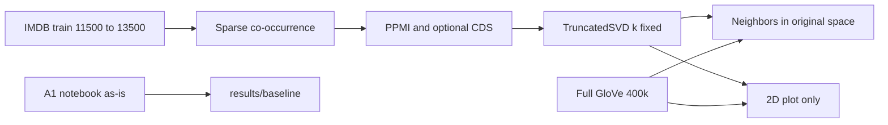

# A1 Embedding Study：第一阶段

在当前 `a1` 工作区新建分支 `a1-embedding-study`。不改 [assignments/a1/student/exploring_word_vectors.ipynb](assignments/a1/student/exploring_word_vectors.ipynb) 里的作业实现和已写答案。研究代码放在 `assignments/a1/research/`。

语料：研究实验用 HuggingFace `stanfordnlp/imdb` 的 **train[11500:13500]**（1000 条负评 + 1000 条正评）。作业 baseline 仍按现有 `train[:150]` 原样重跑。全部计算在本机 **M1 Pro（10 核，32 GB）** 上完成，使用 `cs224n` 环境。

## 已确认的语料与算力

HuggingFace 这份 IMDB 的 train 按标签排好序：`[0, 12500)` 全是负评，`[12500, 25000)` 全是正评。因此 `train[:150]` 和 `train[0:2000]` 都是纯负评。研究子集改成跨过分界的 `train[11500:13500]`，正负各 1000，索引范围固定，写入 `config.py`。

已在本机缓存上按作业同一套预处理量过这段（小写、`re.sub(r'[^\w]', '', ...)`、`<START>` / `<END>`）：

- 2000 篇，原文 **2.52 MiB**，**470,407** token，平均 235 token / 篇
- 词表 **29,052**；count ≥ 10 的词 **3,937**（evaluation vocabulary）
- 窗口 4 的共现矩阵：**1,429,134** 个非零项，密度 0.17%，CSR float64 约 **16.5 MiB**
- 若建成稠密 float64 矩阵则约 **6.3 GiB**。实现保持 `scipy.sparse`，不物化这张稠密矩阵

第一阶段是稀疏共现、PPMI 和 `sklearn.TruncatedSVD`，再加上本地已有的 GloVe 查询。这些库走 CPU。按上面的规模，SVD 扫描加几个 seed 预计是几分钟到十几分钟。后续同语料的 CBOW / SGNS 用 gensim，同样是 CPU，47 万 token 的一次训练一般是几分钟。这一阶段不使用 Hugging Face GPU。

## 现有作业里要对齐的不一致

这些写进 baseline 记录，扩展代码按记录的规模执行，不回头改作业 notebook。

- 正文写 25,000 train + 25,000 test。代码是 `NUM_SAMPLES = 150`，只取 `imdb_dataset["train"]["text"][:150]`。已保存输出里共现 SVD 的词表是 **5,880**。
- `print("corpus size:", len(imdb_corpus[0]))` 打的是第一篇的 token 数（输出 290），不是文档数。
- 正文写抽取 **40,000** 个 GloVe vectors。`get_matrix_of_vectors()` 遍历 `wv_from_bin.index_to_key` 全部词。已保存输出是 **400,000**。
- 文首 `np.random.seed(0)` / `random.seed(0)` 盖不住两处随机性：`get_matrix_of_vectors` 内部 `random.seed(225)`，`TruncatedSVD` 没有 `random_state`。
- 共现矩阵是 `np.zeros` 稠密矩阵。150 条、5,880 词大约可接受；词表再大就会撑爆内存。预处理还会把标点清成空字符串 token。

扩展版的明确选择：

- IMDB 研究语料：`train[11500:13500]`，预处理与作业相同（小写、`re.sub(r'[^\w]', '', ...)`、`<START>`/`<END>`），并记录空 token 是否保留。标签分布是 1000 负 + 1000 正。
- 2D GloVe 可视化：固定抽取 **40,000** 个向量（seed 固定），并强制加入 query words。原始空间里的 neighbor / analogy 仍用完整 `glove-wiki-gigaword-200`（400,000 × 200），不把 2D 投影当成 evaluation。
- 共现与 PPMI 用 `scipy.sparse`，不对全词表做 pairwise 矩阵。

## 目录与可复现配置

```
assignments/a1/research/
  README.md
  config.py                 # 唯一配置入口
  src/                      # corpus, sparse counts, ppmi, svd, neighbors, analogy
  notebooks/phase1.ipynb    # 第一阶段可读笔记
  papers/                   # 八篇短笔记
  results/baseline/         # 原 notebook 输出快照
  results/phase1/           # json/csv 指标，不提交巨大矩阵
```

[config.py](assignments/a1/research/config.py) 固定并在每次运行时 dump 到 `results/phase1/config.json`：

- corpus：`stanfordnlp/imdb`，split `train`，index `[11500, 13500)`，并记录标签计数（1000 neg / 1000 pos）
- preprocessing、window=4、词表排序规则（与作业 `distinct_words` 一样按字符串排序）、`word2ind` 写成 json
- `SEED = 0`；`TruncatedSVD(..., random_state=SEED, n_iter=10)`
- 同一组 query words：作业里的 `movie, book, mysterious, story, fascinating, good, interesting, large, massive, huge`
- evaluation vocabulary：语料中 count ≥ 10 的词；neighbor 只在这个集合里检索
- 记录 `numpy/scipy/sklearn/gensim/datasets` 版本和 Python 版本

GloVe 仍用作业环境里的 `gensim.downloader` `glove-wiki-gigaword-200`。训练语料是 Wikipedia 2014 + Gigaword 5，约 60 亿 token，与 IMDB 子集不是同一分布。这个差别写进配置和 GloVe 小节，避免把差距全部算到算法上。




## 第一阶段要做完的实验

### Baseline

用现有 `cs224n` 环境执行 [exploring_word_vectors.ipynb](assignments/a1/student/exploring_word_vectors.ipynb)，把 stdout、图和上述不一致点存到 `results/baseline/`。不改作业 cell。

### 模块 A：Raw counts 到 PPMI

对应作业 1.2–1.3。阅读笔记：[Levy & Goldberg 2015](https://aclanthology.org/Q15-1016/)，用 Arora et al. 2016 的短段说明 PMI 与 inner product 的近似关系，不复现证明。

- 手算小语料：打印 raw counts、word/context marginals、PMI、PPMI，并与手算结果逐项对照。语料里同时放一个高频功能词对和一个只共现一次的词对。
- 同一 IMDB 子集上三条线：Raw counts + SVD、PPMI + SVD、PPMI + context distribution smoothing（α = 0.75）+ SVD。维度先固定为 k=50。
- 固定 query words 的 top-10 neighbors（cosine，在 evaluation vocabulary 内）。主结果用 seed 0；再跑 seed 1 和 2，只报告 neighbor overlap，避免一次随机 SVD 下结论。
- Notebook 里直接回答：高 count 为什么不等于强语义关联；PMI 为什么放大 rare events；PPMI 与 raw counts 的 neighbors 为什么不同。

### 模块 B：维度与可视化

对应作业 1.3–1.5。阅读笔记：Yin & Shen 2018。固定表示用 **PPMI**（不含 CDS）。

- k = 2, 10, 25, 50, 100（若词表不足则把上限降到词表大小以下）。
- 每个 k：固定 query 的 top-10 neighbors；相对 k=100 的 top-10 Jaccard；reconstruction 用 `||M||_F^2 - sum(singular_values^2)`，不把 rank-k 重构物化成稠密矩阵。
- PIP 只在固定的 evaluation subset 上算（最多 500 个词，按词频取，写入配置）。reference 是 k=100 的 PPMI-SVD。PIP loss 只表示“保留这个 reference 的程度”，reference 不是真实语义。
- 同一组词比较原始空间 neighbors 和 2D 投影 neighbors，作为 projection distortion 例子。
- 用一个固定正交矩阵旋转 k=50 向量，检查 cosine neighbors 与 PIP 不变。
- 回答：2D clustering 为什么不能代表原向量；整体旋转为什么不应改变关系质量；reconstruction error 更小为什么不保证语义更好。

### 模块 D 基础：多义词

对应作业 2.2。阅读笔记：Arora et al. 2018。这一阶段只做基础实验，不做 context clustering 和 sparse coding。

- 词：`bank, plant, tie, bark`。在完整 GloVe 上取 top-10 和 top-30，做 sense 标注表。
- 从 IMDB `train[11500:13500]` 抽这些词的 context。若某个词在子集里几乎只有一种用法，记成数据限制。
- 回答：top-10 没有某个 sense 是否等于向量没保存它；常见 sense 为什么盖住低频 sense；neighbor 分组是否一定等于词典义项。

### 模块 E：Analogy

对应作业 2.4–2.6。在 **完整 GloVe** 上做，因为 country–capital 等关系不在电影评论里。候选排除规则固定：去掉 analogy 的三个输入词。OOV 单独计数。

小型测试集，每类若干条，写成 json：

- country–capital
- singular–plural
- adjective–comparative
- family
- 容易被多义词干扰的关系（沿用作业里 hand/glove/foot、bark 这类失败例，并补同类）

指标：top-1、top-5、intended answer 的 rank、无法评价的条数。另做一组：单个 word pair 的 offset，对比多个 training pairs 的 average offset；evaluation pairs 不参与构造 offset。

回答：方向相似为什么仍可能检不到目标词；多义词、词频、候选词表如何影响结果；多个例子稳定成立比一个著名例子多说明了什么。Arora 2016 只用来解释 linear structure 的假设，不把 analogy 写成必然成立的代数规则。

## 这一轮只写占位、不跑的部分

在 `papers/` 和 `phase1.ipynb` 末尾留下短笔记和实验占位，方便后面接上：

- 模块 C：同 corpus（仍是 `train[11500:13500]`）的 CBOW / SGNS（gensim，本机 CPU）、window / subsampling / negative samples 单因素 ablation、多 seed。同 corpus GloVe 训练放到第三阶段，规模仍是这 47 万 token，继续在 M1 Pro 上跑。
- 模块 D 进阶：context-vector clustering；简化 sparse coding。标明二者都不是论文方法的完整复现。
- 模块 F：word similarity rank correlation、跨任务表、可选 IMDB sentiment downstream。Bias 题（作业 2.7–2.9）保留在原 notebook，研究笔记里只加一段 evaluation coverage 与 bias 的关系，不做 debiasing 实验。

八篇笔记各一页：Mikolov 2013a、2013b、GloVe 2014、Levy 2015、Arora 2016、Schnabel 2015、Arora 2018、Yin & Shen 2018。每篇只写：这篇回答什么、第一阶段用到哪一段、故意不复现什么。

## 完成标准

同一份 `config.json`、`word2ind.json` 和 package versions 能让第一阶段重跑。`phase1.ipynb` 能独立读完：手算核对、neighbor 表、dimension 曲线、2D distortion 例子、sense 表、analogy 表，以及上述问题的简短回答。大矩阵留在本地 `results/`，不写进 notebook。